# Robotrek: New Bot Types v1.0

A Robotrek (USA) patch with three robot classes, distinct combat strengths and class labels in the native menus. The original sprites, artwork and campaign remain at the heart of the game. Class names appear in the roster, detailed status, equipment, Program/Skill and stat-allocation/body-color screens. The equipment label follows the top-left rivet above the robot name; the Program/Skill header also follows its top-left rivet.

**[Download v1.0](https://github.com/RetchERez/Robotrek-New-Bot-Types/releases/download/v1.0/Robotrek_New_Bot_Types_v1.0.zip)** · [Plain-text instructions](README.txt) · [Release notes](RELEASE_NOTES.md)

The release ZIP contains exactly the BPS patch and README.txt. Supply your own clean game ROM.

## Meet the classes

| Class | Specialty | Melee / gun / bomb damage | Movement | Tradeoff |
|---|---|---|---|---|
| **INFILTRATOR** · Blue | Swords and close-range positioning | 115% / 72% / 75% | +1 tile | Low starting Guard |
| **HUNTER** · Green | Guns and lasers | 82% / 115% / 82% | Normal | Gun actions add one recovery unit |
| **JUGGERNAUT** · Red | Bombs and a sturdy starting build | 93% / 75% / 112% | +1 tile | Low starting Charge |

Damage rates apply to normal attacks and RUN programs. Hunter's extra recovery applies once to a gun-containing RUN program and respects the native 12-unit cap; a full gauge stays at 12.

| Starting minimums | Energy | Power | Guard | Speed | Charge | Total |
|---|---:|---:|---:|---:|---:|---:|
| INFILTRATOR | 21 | 5 | 2 | 8 | 4 | 40 |
| HUNTER | 21 | 8 | 4 | 4 | 3 | 40 |
| JUGGERNAUT | 24 | 6 | 7 | 2 | 1 | 40 |

These are permanent class minimums. Develop and redistribute points above them as your robots grow. Owned classes are greyed out in the purchase menu: highlight them to inspect their stats, but confirmation does nothing. You can own one of each class, with native purchase prices of 2,000 GP, 3,000 GP and 4,000 GP for successive robots.

The purchase selector previews Energy, Power, Guard, Speed and Charge, plus sword/gun/bomb damage multipliers and the class penalty before you buy it. LOW GUARD means low starting Guard; GUN DELAY +1 means one extra gun recovery unit, capped at the native 12; MOVE -1 TILE means one fewer tile of battle movement.

## Screenshots

| Choose your class | All three robots | Opening battle |
|---|---|---|
| 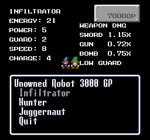 | 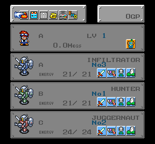 | 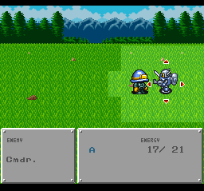 |

| INFILTRATOR | HUNTER | JUGGERNAUT |
|---|---|---|
| 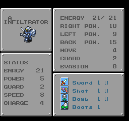 | 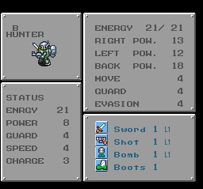 | 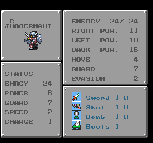 |

| Class-labelled Program screen | Two swords | Two guns |
|---|---|---|
| 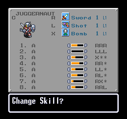 | 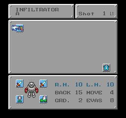 | 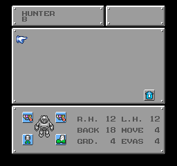 |

| Stat allocation and body color | Hunter purchase preview | Juggernaut purchase preview |
|---|---|---|
| 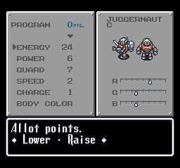 | 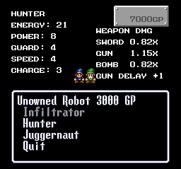 | 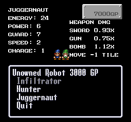 |

These are actual native captures from the final build. The dual-weapon demonstrations use an explicitly prepared transfer of already-owned equipment.

## Gear and RUN programs

Commands select equipment slots: **R = right arm, L = left arm, X = back weapon**. They do not specify a weapon family. With two guns, RL uses two guns; with two swords, RL uses two melee weapons.

| Class | Gear to work toward | Programs to try | Practical advice |
|---|---|---|---|
| **INFILTRATOR** | A sword in each arm, bomb on the back and boots | RR, RRR; RL with two swords | Move into melee range first; a right-arm sword and left-arm shield offer a defensive alternative while retaining RR/RRR |
| **HUNTER** | A gun in each arm, boots and an optional back bomb | R or L for normal slot attacks; RR, LL or RL for short RUN choices; longer repeats when costs fit | Both arms can use the class bonus; costly lasers may require a shorter program, and a normal shot can be more useful against some enemies |
| **JUGGERNAUT** | Back bomb, right-arm melee weapon, left-arm shield and boots | X; RX when the melee part can reach | Favor a single bomb when melee would miss; use boots and positioning to offset reduced movement |

For a defensive Hunter setup, equip a gun in the right arm and a shield in the left, then use R-based attack programs.

Opening equipment includes one Sword1, Shot1, Bomb1 and Boots1 per robot. Dual-weapon setups require a spare weapon or a transfer from another robot; the class choice does not grant a second sword or gun.

At the R&D machine, choose Program, select a robot and choose Skill. Enter the commands, confirm and name the program. In battle, select it from RUN. The list has two columns, so move right to reach the second column.

- Have the program screen accept a recipe with your actual equipped weapons before relying on it
- Keep a short option alongside a longer program and compare results against the same enemy
- Three costly laser components may exceed capacity even when two fit
- Do not plan around XX when two bombs cost 16 units: the native gauge holds 12
- Invest in Energy and Guard as well as damage, and raise Charge to shorten recovery
- Check positioning before committing to melee and switch robots when another class suits the fight

These are starting options, not a universal ranking. Equipment costs, weapon level, range and enemy defense affect the result. Native misses, criticals and the 999 damage cap remain in effect.

## Installation

- Extract [Robotrek_New_Bot_Types_v1.0.zip](https://github.com/RetchERez/Robotrek-New-Bot-Types/releases/download/v1.0/Robotrek_New_Bot_Types_v1.0.zip)
- Supply a clean, unheadered Robotrek (USA) ROM of exactly **1,572,864 bytes**
- Apply the included BPS patch with a BPS-compatible patcher to that clean ROM
- Save the patched ROM separately and open it in your emulator
- Start a new game to choose your classes normally

Apply each release to the clean game rather than an older patched ROM. The patched output is 2,097,152 bytes. A game ROM is not included.

## Existing saves

A new game is recommended. Back up existing saves before transferring them, and use a native battery save; savestates depend on emulator and version.

R45 and newer battery saves use the same class format as this final build. R42–R44 Dark Signal saves require explicit conversion because class data moved. The optional [save converter](tools/CONVERT_R42_R44_SAVE.py) and [conversion instructions](docs/save-conversion.txt) are supplied separately from the release ZIP.

Earlier builds could overwrite the third robot's skills 3–6. Conversion resets those four skills and their names by default, so reprogram them afterward. It cannot reconstruct data already lost. Existing untyped robots display UNKNOWN and retain native behavior.

## Validation and reports

Earlier checkpoint testing covered ordinary attacks, melee/gun/bomb/mixed RUN programs, recovery, saved classes and programs, native saving and loading, roster ordering, Copy/Erase Log, representative status effects, KO/Repair and the ending path. Native menu checks covered class labels, purchase previews, navigation, cancellation, owned choices, insufficient funds, stat changes and body-color changes.

Final release checks focus on choosing each class as the first purchase, blocking owned choices, selecting the remaining third class, native saving and cold loading of all three classes, all eight program slots and their names on each robot, the three normal weapon families and five specialist or mixed RUN examples, and Hunter recovery at the full 12-unit cap. The BPS patch and native ROM title are also checked independently.

Testing uses representative checkpoints. A continuous full playthrough and every possible equipment, program and stat combination remain untested. If you encounter a problem, use the bug-report template and include the release, emulator, steps and a screenshot when useful.

## File verification

| File | SHA-256 |
|---|---|
| Clean Robotrek (USA) ROM | `1e2ded7b1e350449b7a99b7ec414525e4b9b086c416deeee5eb3e48e032c46bd` |
| Patched New Bot Types v1.0 ROM | `aae1caf3db48f5d2e1cea78b08efe2d3756ca1b5f8974163da1644530468c053` |
| BPS patch | `05268a257ecd00869d678017e4f9232ac48ac480acab1fb096a39b0ad61a0cda` |

The native ROM title is `NEW BOT TYPES V1.0`.
